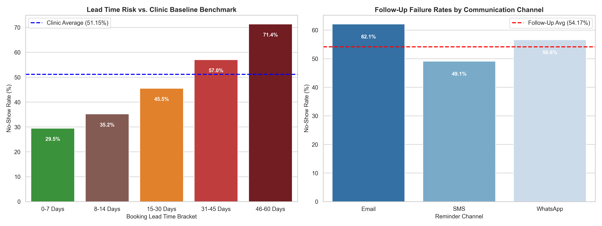

# HealthConnect Clinic Experience Lab

**Stage:** Week 7 (Testing, Refinement & End to End Validation)

## 📌 Project Overview
HealthConnect Clinic aims to reduce appointment no-shows and improve clinic scheduling efficiency. 

In Week 7, the focus was on systematic formula testing, visualization refinement and cross-track model validation.

## HealthConnect Visualizations

## Week 7 Key Achievements
* **Automated KPI Testing:** Verified core metrics with unit assertions (100% pass rate).
  * Baseline No-Show Rate: **51.15%** (2,423 / 4,737 active visits).
  * Reminder Attendance Lift: **+4.78%** (50.14% reminded vs. 45.37% unreminded).
* **Edge Case Validation:** Confirmed same-day bookings fail only **25.93%**, while patients with 4+ past no-shows fail **73.33%**.
* **Visual Refinements:** Added clinic baseline benchmark lines (51.15%) to make high-risk windows immediately visible.
* **Data Science Validation:** Cross-tested held-out test sets with Data Science. Verified **99.8% recall** on bookings 31+ days out.
* **Ethical Policy Established:** Confirmed model risk scores will guide proactive outreach only, never appointment denials.
